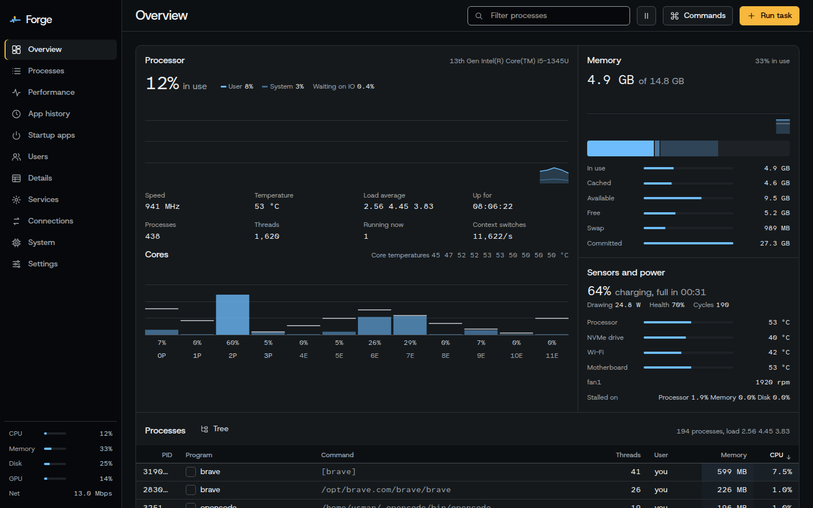

# Forge

A vibe coded system monitor for Linux that puts Windows Task Manager's pages and btop's density in one window. Rust and Tauri 2; the window uses the system WebKitGTK, so the release binary is about 4 MB.



## What it does

| Page | What you get |
| --- | --- |
| Overview | btop's single screen: the CPU trace over a per-core strip (peak hold, amber marks where the picked process last ran), memory composition, temperatures, fans, battery, pressure stall, network and disk traces, GPU engines, and the process list with a tree view. |
| Processes | Task Manager grouping: apps (merged by app, launched apps detected from systemd scopes and desktop entries), background processes, system and other users, kernel threads. Heat-shaded CPU, memory, disk and GPU columns with totals in the header. Grouped, tree or flat. |
| Performance | One page per device: processor (overall, every logical processor, or performance against efficient cores), memory, each disk (active time, response time, throughput), each network adapter, each GPU (per-engine graphs), battery. 1 minute to 1 hour of history. |
| App history | CPU time, disk reads and writes, GPU time and peak memory per app, kept across sessions. |
| Startup apps | XDG autostart entries: enable, disable, add, remove, and whether each is running now. |
| Users | Per-user totals with their processes, sessions, lock and sign out. |
| Details | Every process with up to 27 columns you choose. |
| Services | systemd system and user services: start, stop, restart, reload, enable, disable, mask, and the journal for each. |
| Connections | Every TCP and UDP socket with the process that owns it. |
| System | Distribution, kernel, hardware, caches, swap, adapters, routes, DNS, every sensor, pressure stall. |

Process actions: end task, kill, end process tree, suspend and resume, efficiency mode (SCHED_IDLE), priority, processor affinity, any of the 31 signals, create a dump file (gcore), open file location, search online, copy command line, and a properties drawer (threads, open files, environment, memory maps, sockets, limits, namespaces). When the kernel refuses an action, Forge offers to retry it through `pkexec`.

Also: command palette (Ctrl K), filter that searches names, PIDs, users, commands, units and containers, container and sandbox detection (Docker, Podman, Flatpak, Snap), per-process GPU from DRM fdinfo, desktop alerts for CPU, memory, temperature and battery, JSON and CSV export, summary view, always on top, three colourways, and full keyboard driving (press `?` in the app).

What it does not show: per-process network traffic (needs root and eBPF) and memory speed or slots (needs root and `dmidecode`).

## Build

Needs Rust, Node 18+, and the WebKitGTK development files:

```sh
sudo apt install libwebkit2gtk-4.1-dev libsoup-3.0-dev libjavascriptcoregtk-4.1-dev build-essential
npm install
npm run dev          # run with live reload
npm run build        # .deb in src-tauri/target/release/bundle/
npm run selftest     # opens every page on live data, prints any UI errors, exits
```

Optional tools Forge uses when present: `lspci` (GPU names), `nvidia-smi` (NVIDIA load), `gcore` (dump files), `nmcli` (connection names), `notify-send` (alerts), `pkexec` (administrator retries).

To work on the UI in a browser, `npm run preview` and open http://localhost:8765. It replays one recorded sample so screens can be designed without the app window.

## Layout

```
src-tauri/src/
  sampler.rs   one sample per tick from /proc and /sys
  gpu.rs       amdgpu busy, i915 RC6, nvidia-smi, DRM fdinfo per process
  apps.rs      desktop entries, app grouping, icons
  actions.rs   signals, priority, efficiency, affinity, dumps, process details
  system.rs    services, startup apps, sessions, sockets, hardware facts
  history.rs   app history file
ui/
  js/pages/    one module per page
  styles/      tokens.css (Console theme, three colourways) and app.css
docs/design.md the options weighed and why
```
